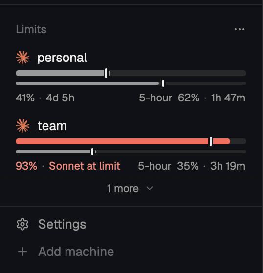
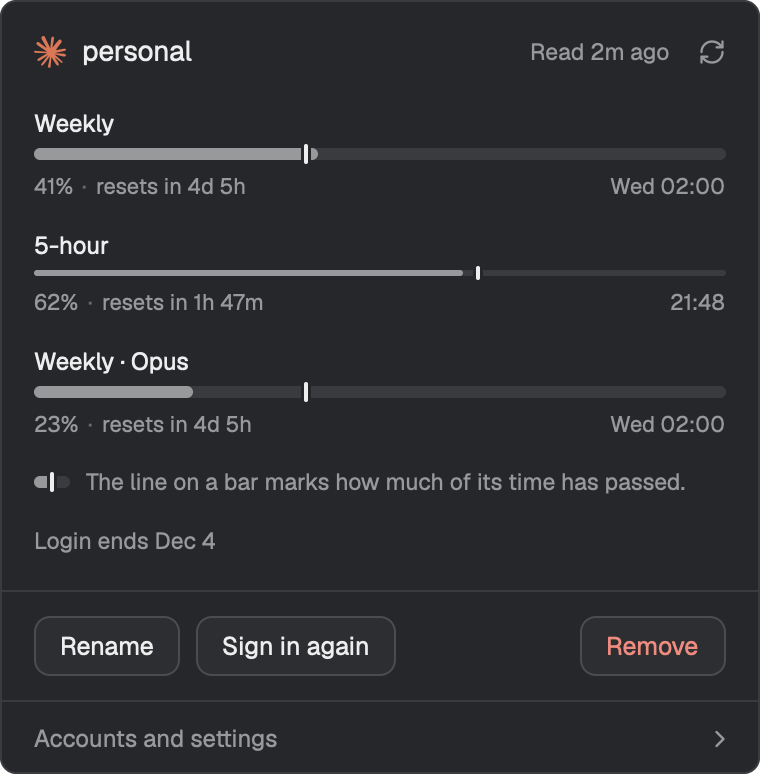
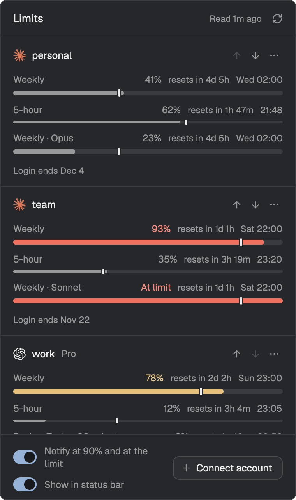
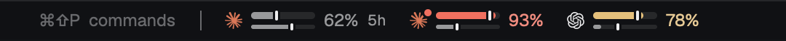

# Headroom

A Herdr mod that shows how close each of your Claude and Codex accounts is to
its usage limits: in the sidebar, in the status bar, or in any block of your
layout.

<p align="center">
  
  &nbsp;&nbsp;
  
</p>

<p align="center">
  <a href="#install">Install</a> ·
  <a href="#connect-an-account">Connect an account</a> ·
  <a href="#what-you-see">What you see</a> ·
  <a href="#using-it-in-your-own-layout">Your own layout</a> ·
  <a href="#privacy-and-security">Privacy</a>
</p>

## Highlights

- **Every account at once.** Claude (Pro or Max) and Codex (ChatGPT)
  subscriptions side by side, one row each, in the order you choose.
- **Weekly and 5-hour bars**, with the percent used and the time until each
  window resets.
- **A pace mark on every bar.** It sits at the share of the window's time that
  has passed. A fill past the mark means the account runs out before the reset
  at its current rate.
- **Per-model and additional limits** in the account's view. A per-model limit
  that is reached is said on the row ("Sonnet at limit").
- **Three forms, one mod.** A list in the sidebar, a rail when the sidebar is
  folded, a strip in the status bar.
- **Toasts** when a window reaches 90 % and when it hits its limit.
- **No CLI needed.** It signs in to each account and reads its usage itself:
  no Claude Code, no Codex CLI.
- **Readings for other mods**, published in Herdr's shared state.

## Install

You need Herdr, started once so its home exists, on macOS or Linux, and `jq`
for the layout.

```sh
git clone https://github.com/MaxiLR/herdr-headroom.git
cd herdr-headroom
scripts/install.sh --layout   # install the mod and add the herdr-headroom layout
herdr-app do layout.switch --name herdr-headroom
```

The layout is a copy of your `main` layout with Limits under Agents in the
sidebar and a strip, hidden until you turn it on, in the status bar.

- `scripts/install.sh --dry-run` prints every step and file and changes
  nothing.
- `scripts/install.sh` alone installs only the mod, for
  [a layout of your own](#using-it-in-your-own-layout).
- Run it again to update. The previous install is moved to `backups/`, and a
  layout that already exists is never overwritten.

[Installing](docs/install.md) covers each step, replacing a layout an earlier
version wrote, and undoing the install.

## Connect an account

Open **Accounts and settings** (the three dots in the Limits header) and choose
**Connect account**. An empty list shows the button too.

- **Claude**: approve on Claude's page, copy the code it shows and paste it
  into the dialog.
- **Codex**: the dialog shows a device code; enter it on OpenAI's page.

A Claude login ends 30 days after sign-in. The row warns during the last 3
days, and "Sign in again" renews it. A Codex login does not end on its own.

[Accounts, readings and notifications](docs/accounts.md) covers labels, how
often accounts are read, and the toasts.

## What you see

| On a row                         | Meaning                                                                               |
| -------------------------------- | ------------------------------------------------------------------------------------- |
| Full bar over a thin bar         | The weekly window over the 5-hour window.                                             |
| Bar colour                       | Normal below 75 %, high from 75 %, critical from 90 %, in your theme's colours.       |
| Tick on a bar                    | The pace mark: how much of the window's time has passed.                              |
| `41% · 4d 5h`                    | Percent used and time until the reset.                                                |
| "At limit"                       | The window is at 100 %, or the provider says the limit is reached.                    |
| "Sonnet at limit"                | A per-model window is at its limit. In the rail and the strip it is a red dot.        |
| Dimmed, with `12m old · network` | The last read failed. The last reading is kept, with its age and the reason.          |
| "Sign in again"                  | The login ended or was rejected. The stored login is kept until you sign in again.    |
| "3 more"                         | Accounts are cut off below. Scroll, or drag the top edge of Limits to make it taller. |

**Click an account** for its view: every window the plan has, the reset's clock
time, a refresh control, and Rename, Sign in again and Remove.

**Accounts and settings** is the one place to manage everything: every window
of every account, arrows that reorder them, Rename and Remove behind three
dots, the notifications switch and Connect account. Remove asks first with the
mod's own dialog, then deletes the account's stored login from this computer.

<p align="center">
  
</p>

**Show in status bar**, a switch in Accounts and settings, turns on the strip
in the installed layout:

<p align="center">
  
</p>

## Using it in your own layout

The mod appears only where a layout puts it. This is the block the installer
adds:

```json
{
  "id": "headroom",
  "type": "block",
  "size": { "px": 111 },
  "min": 90,
  "content": { "mod": "headroom", "props": { "fit": "headroom" } }
}
```

`fit` names the block's own id. The mod then sizes the block to its first two
accounts and keeps a size you drag. The block's measured size picks the form:

| Block                | Form  |
| -------------------- | ----- |
| Narrower than 160 px | Rail  |
| Under 48 px tall     | Strip |
| Anything else        | List  |

[Using it in your own layout](docs/layout.md) has every prop and form, the
status row the installer writes, and how another mod or a shell command opens
the views.

## For other mods

The current readings are published in Herdr's shared state under
`headroom.readings`, one entry per account with its status and windows:

```js
import { shared } from "herdr";

const readings = shared("headroom.readings");
const accounts = readings?.version === 1 ? readings.accounts : [];
const weekly = accounts[0]?.windows.find((window) => window.id === "7d");
```

[`headroom.readings`](docs/readings.md) documents every field.

## Privacy and security

- **Hosts.** It talks to `api.anthropic.com`, `auth.openai.com` and
  `chatgpt.com`, and only to sign in, refresh a token and read usage. Sign-in
  opens `claude.ai`, `platform.claude.com` or `auth.openai.com` in your
  browser.
- **Logins** are stored in `<Herdr home>/headroom/vault.json`, readable by you
  alone (mode 0600) and outside `mods/`, so sharing the mod folder never
  carries a login. The installer never touches it.
- **Shared state** holds labels, ids, plans and numbers, never a token or an
  email.
- **Programs.** It runs `open` or `xdg-open` for the sign-in page, and `mkdir`,
  `chmod` and `stat` on the vault.

> [!WARNING]
>
> - The sign-in and usage endpoints are undocumented, and the mod signs in with
>   the providers' own first-party client ids (Claude Code's and Codex's),
>   which neither provider has approved for third-party use. Either provider
>   can change or close them without notice.
> - `vault.json` is a login. The Claude token carries inference scope, so a
>   leaked file equals a leaked Claude Code login, and every installed Herdr
>   mod runs as you and could read it.

[What it contacts, stores and runs](docs/privacy.md) lists every address, file
and program.

## Development

```sh
npm ci
npm test               # node --test 'tests/*.test.mjs'
npm run format:check   # prettier --check .
npm run check          # herdr-app check mods/headroom
```

The tests run the logic and the providers under node against fakes, draw the
forms with `herdr-app check --print-spec`, and run the installer against
temporary Herdr homes, never the live one.

```
mods/headroom/
  main.js      the View: picks a form from props and the measured size
  logic/       plain modules, no gpui-kit or herdr imports
  providers/   one adapter per provider: claude.js, codex.js
  ui/          one module per form and dialog, and the shared kit
  icons/       the mod's own SVGs
scripts/       install.sh: copies the mod into a Herdr home
tests/         node --test, with fixtures and helpers
```

Written against herdr-app 0.1.15. [`CONTEXT.md`](CONTEXT.md) defines the terms,
[`RECIPE.md`](RECIPE.md) is the brief to build the mod from scratch, and
[`DESIGN.md`](DESIGN.md) and [`PRODUCT.md`](PRODUCT.md) record the design.

## Credits

The sign-in, refresh and usage-read method comes from
[oh-my-pi](https://github.com/can1357/oh-my-pi) (MIT). That, and the sources of
the provider logos, are in [`NOTICE`](NOTICE).
